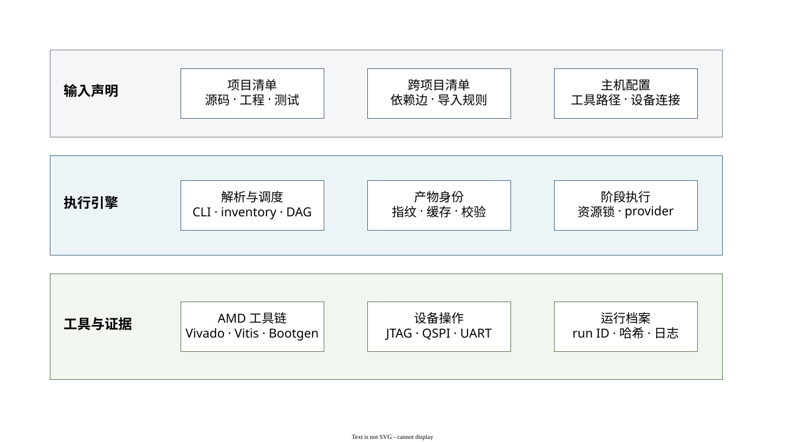

# FPGAFlow

FPGAFlow 是面向 AMD Vivado/Vitis 工程的 Python 构建工具。它依据项目清单执行构建、验证和部署，使用内容指纹复用产物，并保存每次运行的输入、命令、工具版本和结果。当前版本为 `0.3.0`，运行环境为 Python 3.15 或更新版本。

## 架构总览



图 1 项目清单描述工程，执行引擎调度阶段，provider 连接工具和设备。运行记录将源码、产物与验证结果关联。详细设计与跨项目流程见[架构说明](docs/architecture.md)。

## 安装与开始使用

```sh
git clone https://github.com/ArthurPan2026/FPGAFlow.git
cd FPGAFlow
python3.15 -m venv .venv
. .venv/bin/activate
python -m pip install '.[uart]'
fpga-flow --version
```

Windows PowerShell 使用 `.venv\Scripts\Activate.ps1` 激活环境。Vivado、Vitis、Bootgen 与板卡驱动按消费项目要求安装。已发布的 wheel 和源码包见 [GitHub Releases](https://github.com/ArthurPan2026/FPGAFlow/releases)。

在 FPGA 工程根目录运行以下命令。

```sh
fpga-flow --project fpga-project.toml inventory
fpga-flow --project fpga-project.toml plan
fpga-flow --project fpga-project.toml build --stage boot --with-deps
fpga-flow --project fpga-project.toml validate --suite host
fpga-flow --project fpga-project.toml history --limit 10
```

## 工程清单与跨项目构建

`fpga-project.toml` 声明工程入口、工具版本、目标板、输入、测试和产物。Vivado XPR、Block Design、RTL、PS 源码和板级规则由消费项目管理。内置 profile 提供通用阶段，`--config` 接受完整 profile。

`fpga-workspace.toml` 把多个项目连接成 DAG，适用于共享 IP 发布、校验导入、消费工程构建和部署。

```sh
fpga-flow --workspace fpga-workspace.toml plan --json
fpga-flow --workspace fpga-workspace.toml run --allow-side-effects --allow-destructive
fpga-flow --workspace fpga-workspace.toml run --include-optional --allow-side-effects --allow-destructive
```

标记 `optional = true` 的回归默认跳过，`--include-optional` 将其纳入执行。导入节点核验发布包 SHA-256、VLNV、版本和来源，保存导入前后文件树哈希。具体格式见 [workspace 使用说明](docs/workspaces.md)。

## 主机配置与执行记录

Vivado/Vitis 路径、硬件服务器和串口保存在仓库外的 `fpga-flow.local.toml`。可通过 `FPGA_FLOW_LOCAL_CONFIG` 指定文件。Linux 状态目录为 `$XDG_STATE_HOME/fpga-flow`，默认 `~/.local/state/fpga-flow`。Windows 使用 `%LOCALAPPDATA%/FPGAFlow`。

每次运行的日志、输入锁、产物和 `run.json` 位于消费工程的 `build/fpga-flow/runs/<run-id>/`。阶段指纹包括输入文件、依赖产物、命令、工具版本和目标身份。缓存命中时核验输出哈希，成功产物保持独立副本。

JTAG、QSPI 和 UART 通过 provider 执行。持久写入使用 `--allow-destructive`，声明的外部副作用使用 `--allow-side-effects`。资源锁协调 Vivado、Vitis、板卡及串口。UART 支持字面或正则断言，并可等待当前命令回显后匹配响应。

## 开发与验证

```sh
PYTHONPATH=src python -m unittest discover -s tests -v
python -m build
```

CI 在 Windows 和 Linux 执行主机测试。本轮 workspace、产物导入、UART、部署与安装验证见 [2026-11-24 交付记录](docs/validation-2026-11-24.md)。版本标签工作流构建 wheel 与源码包。

## 许可

FPGAFlow 使用 [Apache-2.0](LICENSE)。
