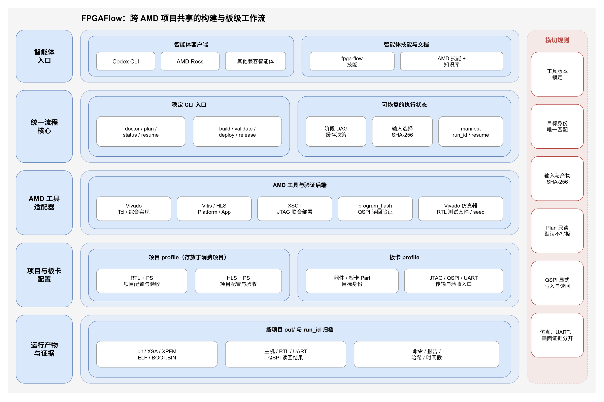

# 架构与设计约束

## 架构图

可编辑源图：[fpga-flow-architecture.drawio](fpga-flow-architecture.drawio)。

## 职责边界

FPGAFlow 是独立版本化的 AMD FPGA 构建、验证和部署 CLI。核心只管理 profile、阶段依赖、工具版本、输入/产物指纹、缓存、运行日志和部署安全；不包含具体项目的 RTL 路径、HLS 组件名、ROM 路径或 UART 命令协议。

每个消费项目在自身仓库维护 `fpga-flow.toml`、项目脚本和测试验收规则。Vivado/Vitis、XSCT、program_flash 与 UART 的具体操作由 provider 实现；目标器件、板卡型号（board part）、JTAG/QSPI 参数和串口身份由目标配置提供。项目已有构建脚本时，可以先通过 argv 命令执行器接入；后续再把稳定的 AMD 操作抽象为内置 provider。

Ross、Codex 或其他智能体通过同一 CLI 工作。AMD Ross 的文档搜索和 Vivado MCP 用于官方资料查询与交互式工程检查；技能只说明如何读取状态和调用工具，不复制执行逻辑或维护第二份聊天状态。参考：[AMD Ross 产品页](https://www.amd.com/en/products/software/ross-agentic-ai.html)、[官方 Ross 技能与 MCP 仓库](https://github.com/Xilinx/ross-ai-assistant)。

## profile 与阶段图

`fpga-flow.toml` 使用 Schema version 1。每个阶段声明 `kind`、`needs`、输入 glob、输出文件或目录、工具版本锁、argv 或 provider、目标和验收标记。HLS 是可选阶段：RTL + PS 项目不需要填写 HLS 字段，也不需要修改核心代码。

每个 stage 的指纹按其实际输入计算，而不是哈希整个仓库。指纹包含：

- 本 stage 选择的输入文件 SHA-256；
- 前置 stage 的具体产物哈希；
- 阶段的 argv、provider 参数、工具执行命令和版本探测命令；
- 目标硬件身份。传输参数按操作隔离：UART 规则变化不会使 PL 构建失效，QSPI 参数变化不会触发 Vivado 综合。

输出 glob 会在执行后展开为具体文件或目录并逐个计算哈希。缓存命中时重新验证所有已记录产物；有任何缺失、损坏、输入变化或目标身份变化都拒绝命中。输入、输出及 manifest 路径会拒绝符号链接和项目根目录外路径。

## 运行记录与恢复

每个操作生成唯一 `run_id`。`out/fpga-flow/manifest.json` 保存阶段当前状态，`out/fpga-flow/runs/<run_id>/run.json` 保存不可变运行记录；标准输出、标准错误、命令 argv、工具探测、输入哈希、依赖产物、输出哈希和耗时均有证据文件。

manifest 原子更新。失败不会覆盖旧的成功运行记录；进程中断时会保留 `running` 状态和已有日志。新的智能体通过 `status --json`、`resume --json` 和只读 `plan` 恢复，不需要重建对话里的操作步骤。

## 构建、验证和部署安全

- `plan` 只读文件与 manifest，不启动工具链、不探测板卡、不写入硬件。
- `build --stage` 只执行一个阶段。需要自动运行前置阶段时，必须显式使用 `--with-deps`。
- `validate` 永远重新检查当前主机/板卡状态，不把先前的板测结果当成永久缓存。
- `deploy` 必须指定已配置的目标。一个目标配置了多种传输方式时，必须用 `--stage` 选定 JTAG 或 QSPI；破坏性部署还需要 `--allow-destructive`。
- QSPI provider 先按配置的身份信息唯一匹配 JTAG 目标，在限定 offset 写入，并强制执行空白检查和读回校验；不提供全片擦除参数。
- UART provider 使用可选的 PySerial，支持 Windows COM 口和 Linux 稳定设备路径；匹配到多个设备或端口被占用时会停止，不会终止占用进程。

## Linux 与 Windows

核心使用 Python 标准库，要求 Python 3.11 或更新版本。路径通过 `pathlib` 处理；profile 中的项目路径统一用项目根目录下的 POSIX 相对格式，带空格的 Windows 工具路径放在 argv 数组中。子进程始终 `shell=False` 执行。UART provider 可通过 `pip install ".[uart]"` 安装 PySerial。

CI 在 Ubuntu 和 Windows 运行同一套测试。本机验证也分别使用 Linux Python 3.15.2 和 Windows Python 3.15.1；硬件测试仍由实际目标 profile 和板卡证据验证。

## 证据级别

- 主机回归记录测试和日志。
- RTL 仿真记录测试套件、随机种子、Vivado/XSim 版本和通过标记。
- 板级运行记录目标身份、部署步骤、UART 收发记录和硬件错误计数。
- QSPI 记录写入偏移、空白检查和读回校验。
- 需要确认显示内容时，视觉验收单独记录；UART 或 RTL 仿真通过不等于画面目视通过。

FPGAFlow 只报告实际收集并验证的证据，不把主机、仿真、串口和画面验收合并成一个笼统结论。
