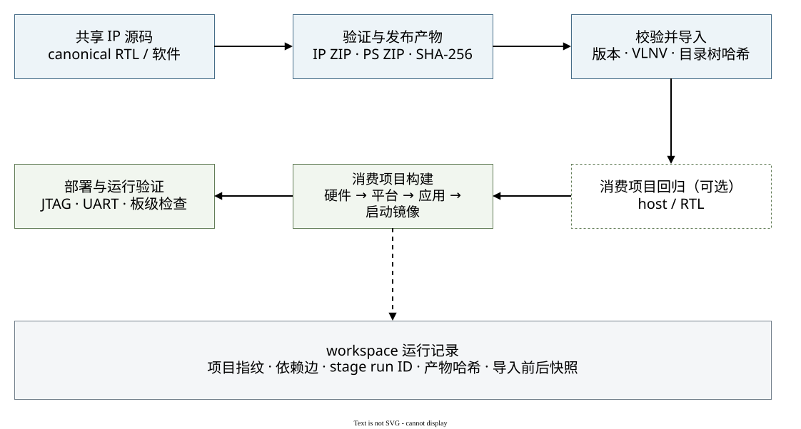

# FPGAFlow 架构

## 模块分工

图 1 输入声明、阶段执行与证据存储。工程文件和板级语义由消费项目提供，执行引擎处理依赖、指纹、缓存与锁。

CLI 解析 `--project`、`--config` 或 `--workspace`。项目描述器读取 XPR、BD、IP-XACT 与显式源码引用，生成 inventory。阶段引擎依据依赖关系选择执行顺序，并调用命令执行器或 provider。

AMD provider 执行 JTAG、QSPI 等操作，UART provider 执行项目声明的命令与断言。进程使用 argv 启动，stdout/stderr 持续保存到运行目录。

## 跨项目 DAG

图 2 共享 IP 从 canonical 源码经过发布校验后导入消费工程。依赖边携带产物身份，可选回归由运行参数选择。

workspace 节点有 `flow` 和 `artifact_import` 两类。前者调用项目阶段，后者消费成功 release 的 IP 与 PS ZIP。导入核对 `SHA256SUMS`、包成员、版本、VLNV、revision 和来源提交，保存替换前后目录树哈希。替换失败时恢复已有目录。

`resources` 指定共享工具和设备。主机状态目录中的资源锁协调多个 workspace。节点失败后，下游节点记录为 blocked。`optional = true` 的节点默认记录为 skipped，`--include-optional` 将其纳入运行。配置示例见 [workspace 使用说明](workspaces.md)。

## 指纹、缓存与运行记录

阶段指纹由输入哈希、依赖产物、argv、工具版本、provider 参数和目标身份组成。缓存命中前重新计算指纹并验证输出哈希。失败尝试与上一次成功产物分别记录。

每次运行保存于 `build/fpga-flow/runs/<run-id>/`，包含 `run.json`、日志和 `work/`。仓库外索引保存阶段摘要与输入锁。`status`、`history`、`resume` 和 `watch` 提供状态、恢复建议与日志查询。

## 工程与设备操作

本地主机 overlay 提供工具路径、连接地址和串口。项目清单保存目标身份、阶段图、输入和产物规则。`doctor` 按所选阶段检查工具及连接配置。

`--allow-destructive` 授权破坏性部署，`--allow-side-effects` 授权清单声明的外部副作用。UART 的 `require_command_echo` 支持全阶段和单步骤设置，响应断言从当前命令回显之后开始匹配。

核心使用 Python 标准库，串口支持由可选依赖 PySerial 提供。CI 覆盖 Linux 与 Windows，测试结果见[交付验证记录](validation-2026-11-24.md)。
